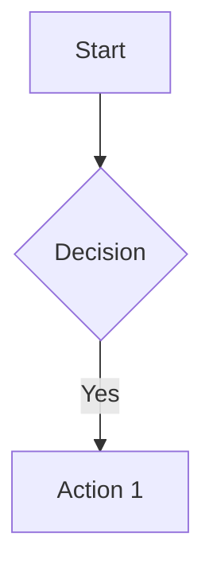

# dexterbrylle.com

Personal notebook and projects built with [Astro](https://astro.build).

**Live:** https://dexterbrylle.com

---

## What This Is

A fast, minimal personal site featuring:

- **Homepage** — Intro, recent notes, and personal projects
- **Notes** — Markdown writing with Mermaid diagram support
- **Building** — Fillo, Eave, and space for future projects and experiments
- **Profile** — Bio, career, and contact information
- **More** — Gear, stack, certifications, and homelab

Built as a static site. Small scripts handle theme switching, navigation, article contents, and the gear viewer. Mermaid diagrams render to SVG at build time. The design ("Hairline", see `DESIGN.md`) uses Geist and Geist Mono, one clay accent, hairline rules, light and dark themes, and CSS-only view transitions.

---

## Tech Stack

| Layer | Choice |
|-------|--------|
| Framework | Astro 7 (Node 24, see `.nvmrc`) |
| Content | Markdown + Content Collections |
| Styling | Plain CSS with CSS variables |
| Diagrams | Mermaid (server-side rendered) |
| Host | Cloudflare Pages |

---

## Writing

Blog posts live in `src/content/blog/`. They're Markdown files with YAML frontmatter:

```markdown
---
title: "Post Title"
description: "A short summary of the note."
pubDate: 2026-10-13
tags: ["software"]
---

Your content here.
```

Mermaid diagrams work inline:

````markdown

````

---

## Projects

Project entries live in `src/content/projects/`. Each Markdown file becomes a page at `/building/<filename>/` and appears in the project index. The first three entries, sorted by `order`, also appear on the homepage.

```markdown
---
title: "Project name"
description: "What it does and who it helps."
status: "Experiment"
order: 3
tags: ["Web"]
links:
  - label: "Visit the project"
    href: "https://example.com/"
---

Write about the project here.
```

Statuses are `Live`, `Coming soon`, `Experiment`, and `Paused`. Optionally add an `icon` path and a `preview` object with `src` and `alt` fields. Put images in `public/images/projects/`; use a path such as `/images/projects/example.webp` in frontmatter.

Notes remain in `src/content/blog/` and publish at `/notes/<filename>/`. The existing `/blog/` URLs redirect to Notes. To publish either kind of entry, add the Markdown file and push to `main`.

For local development and builds on a machine with Google Chrome but no bundled Playwright browser:

```sh
MERMAID_BROWSER_CHANNEL=chrome npm run dev
MERMAID_BROWSER_CHANNEL=chrome npm run build
```

IBM Plex Sans and IBM Plex Mono are self-hosted, so the site makes no Google Fonts requests. Fenced code blocks with a language label, such as `js`, `ts`, `json`, or `sh`, get syntax highlighting in both themes. Mermaid labels use Plex Sans at their natural size; diagram articles use the available width without widening the prose. On smaller screens, focus a diagram and use the arrow keys to pan.

To verify typography, highlighting, and diagram layout against a running local server:

```sh
MERMAID_BROWSER_CHANNEL=chrome VERIFY_URL=http://127.0.0.1:4321 node scripts/verify-reading.mjs
```

---

## Deployment

Cloudflare Pages builds and deploys pushes to `main` directly through its Git integration with `dexterbrylle/dexterbrylle.github.io`. GitHub Actions is not required.

Deployment URL: https://dexterbrylle.pages.dev/

The Pages project uses these build settings:

| Setting | Value |
|---------|-------|
| Production branch | `main` |
| Framework preset | Astro |
| Build command | `npx playwright install chromium && npm run build` |
| Build output directory | `dist` |
| Root directory | Repository root |
| Environment variable | `NODE_VERSION=22` |

Cloudflare installs npm dependencies before the build command. Chromium is required to render Mermaid diagrams to SVG. The site uses Astro's static output and does not need a Cloudflare SSR adapter.

To finish the custom domain migration, add `dexterbrylle.com` through the Pages project's custom domains settings and apply the DNS change Cloudflare requests. Verify HTTPS and the diagram pages on the custom domain before unpublishing the old site in GitHub's repository Settings → Pages.

---

## Structure

```
├── src/
│   ├── content/blog/       # Notes
│   ├── content/projects/   # Projects and experiments
│   ├── data/               # Navigation, profile, and inventories
│   ├── layouts/            # Astro layouts
│   └── pages/              # Routes
├── public/                 # Static assets and project images
└── dist/                   # Build output
```

---

## License

MIT
