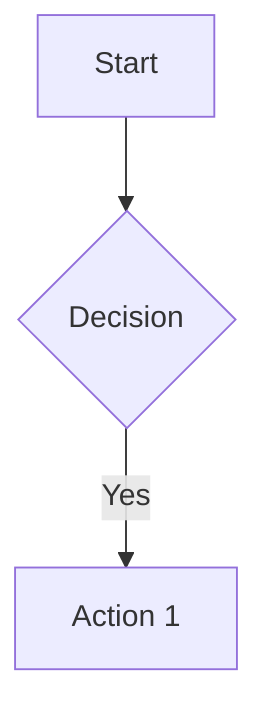

# dexterbrylle.com

Personal notebook and projects built with [Astro](https://astro.build).

**Live:** https://dexterbrylle.com

---

## What This Is

A fast, minimal personal site featuring:

- **Homepage** — Intro, recent notes, and personal projects
- **Notes** — Markdown writing with Mermaid diagram support
- **Building** — Fillo, Eave, and space for future projects and experiments
- **Profile** — Bio, career, and contact information
- **More** — Gear, stack, certifications, and homelab

Built as a static site. Small scripts handle theme switching, navigation, article contents, and the gear viewer. Mermaid diagrams render to SVG at build time. The design uses quiet typography, light and dark themes, and simple document lists.

---

## Tech Stack

| Layer | Choice |
|-------|--------|
| Framework | Astro 5 |
| Content | Markdown + Content Collections |
| Styling | Plain CSS with CSS variables |
| Diagrams | Mermaid (server-side rendered) |
| Host | GitHub Pages + Cloudflare |

---

## Writing

Blog posts live in `src/content/blog/`. They're Markdown files with YAML frontmatter:

```markdown
---
title: "Post Title"
description: "A short summary of the note."
pubDate: 2026-10-13
tags: ["software"]
---

Your content here.
```

Mermaid diagrams work inline:

````markdown

````

---

## Projects

Project entries live in `src/content/projects/`. Each Markdown file becomes a page at `/building/<filename>/` and appears in the project index. The first three entries, sorted by `order`, also appear on the homepage.

```markdown
---
title: "Project name"
description: "What it does and who it helps."
status: "Experiment"
order: 3
tags: ["Web"]
links:
  - label: "Visit the project"
    href: "https://example.com/"
---

Write about the project here.
```

Statuses are `Live`, `Coming soon`, `Experiment`, and `Paused`. Optionally add an `icon` path and a `preview` object with `src` and `alt` fields. Put images in `public/images/projects/`; use a path such as `/images/projects/example.webp` in frontmatter.

Notes remain in `src/content/blog/` and publish at `/notes/<filename>/`. The existing `/blog/` URLs redirect to Notes. To publish either kind of entry, add the Markdown file and push to `main`.

For local development and builds on a machine with Google Chrome but no bundled Playwright browser:

```sh
MERMAID_BROWSER_CHANNEL=chrome npm run dev
MERMAID_BROWSER_CHANNEL=chrome npm run build
```

IBM Plex Sans and IBM Plex Mono are self-hosted, so the site makes no Google Fonts requests. Fenced code blocks with a language label, such as `js`, `ts`, `json`, or `sh`, get syntax highlighting in both themes. Mermaid labels use Plex Sans at their natural size; diagram articles use the available width without widening the prose. On smaller screens, focus a diagram and use the arrow keys to pan.

To verify typography, highlighting, and diagram layout against a running local server:

```sh
MERMAID_BROWSER_CHANNEL=chrome VERIFY_URL=http://127.0.0.1:4321 node scripts/verify-reading.mjs
```

---

## Deployment

Pushes to `main` auto-deploy via GitHub Actions. The workflow:

1. Runs `astro check && astro build`
2. Uploads to GitHub Pages
3. Cloudflare serves from custom domain with SSL

See `.github/workflows/deploy.yml` for the full pipeline. Feature branches run CI without deploying.

---

## Structure

```
├── src/
│   ├── content/blog/       # Notes
│   ├── content/projects/   # Projects and experiments
│   ├── data/               # Navigation, profile, and inventories
│   ├── layouts/            # Astro layouts
│   └── pages/              # Routes
├── public/                 # Static assets and project images
└── dist/                   # Build output
```

---

## License

MIT
